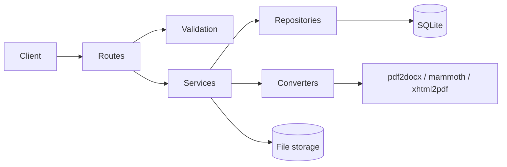

# document-converter

HTTP API that converts **PDF → DOCX** and **DOCX → PDF**.

The API is a Flask application. Metadata lives in **SQLite** (the default and only database). File bytes live on disk. Request handling follows a repository pattern: routes do not talk to SQL, and repositories do not know about HTTP.

| Document | What it covers |
| --- | --- |
| [docs/ENDPOINTS.md](docs/ENDPOINTS.md) | Every route, status code, and error |
| [docs/API_INTEGRATION.md](docs/API_INTEGRATION.md) | curl, Python, and JavaScript clients |

## What it does

- Upload a PDF or DOCX and get back a document resource.
- Upload, convert, and receive the file in one request through `/api/v1/convert`.
- Convert that document to the other format. PDF can only become DOCX. DOCX can only become PDF.
- Download the result, list history, and delete documents or conversions.
- Exercise the API from the browser tester at `/web/debug`.
- Reject bad uploads before they are stored: size, extension, magic bytes, truncated PDFs, and oversized DOCX archives.
- Record a failed conversion instead of pretending it never happened.
- On startup, mark conversions that were interrupted by a crash as `failed`, and delete files that are no longer referenced.

There is no authentication. Run it on a trusted network, or put it behind a reverse proxy that adds auth.

## Repository pattern

A request crosses four layers. Each layer has one job.



| Layer | Module | Allowed to | Not allowed to |
| --- | --- | --- | --- |
| Routes | `app/routes/` | Read the HTTP request, call a service, set status and headers | Write SQL, open uploaded files by hand, call pdf2docx |
| Validation | `app/validation.py` | Check query, JSON, and file bytes. Return every independent field error at once | Decide whether a conversion may be deleted |
| Services | `app/services/` | Business rules, transactions, file lifecycle | Build HTTP responses, embed SQL strings |
| Repositories | `app/repositories/` | Parameterized SQL for one table family | Import Flask, interpret status codes, convert files |
| Converters | `app/converters/` | Turn a source file into a target file | Read the database or the request |
| Database | `app/database.py` | Open SQLite, apply the schema, hand a connection to a unit of work | Know what a "conversion" means beyond the tables |

A **unit of work** is one SQLite transaction. `DocumentRepository` and `ConversionRepository` share that connection. The service commits if the block finishes, and rolls back if it raises. File writes happen outside the transaction: the service stores the bytes first, then inserts the row, and deletes the bytes if the insert fails.

That split is what "repository pattern" means in this project. The repository is the only way to load and save `Document` and `Conversion`. Swapping SQLite for another engine later would mean replacing `app/database.py` and the two repositories, not the routes.

### Business rules that live in the services

- A PDF converts only to DOCX, and a DOCX converts only to PDF. Asking for the same format is a `422` and does **not** create a conversion row.
- A conversion row is inserted as `processing` before the converter runs. Success sets `completed` and links an output document. Failure sets `failed` and keeps the source.
- Client mistakes (unknown id, bad JSON, wrong format) do not create a row. Converter failures do, so you can inspect them later.
- Deleting a document that still has conversions returns `409`, unless you pass `cascade=true`.
- Deleting a conversion removes its output document and file. The source document stays.
- Output files are checked again after conversion. An empty file or the wrong format fails the job.
- Storage names are generated UUIDs. The original filename is metadata only, so a client cannot choose a path.

## Conversion libraries

| Direction | Primary library | Fallback |
| --- | --- | --- |
| PDF → DOCX | [pdf2docx](https://github.com/dothinking/pdf2docx) | LibreOffice (`soffice`) if pdf2docx fails and LibreOffice is installed |
| DOCX → PDF | LibreOffice if `soffice` is on `PATH`, otherwise [mammoth](https://github.com/mwilliamson/python-mammoth) (DOCX → HTML) and [xhtml2pdf](https://github.com/xhtml2pdf/xhtml2pdf) (HTML → PDF) | The pure-Python path is the default when LibreOffice is absent |

Fidelity notes:

- Digital PDFs with a real text layer convert best. A scanned PDF without text still becomes a DOCX, but it will not magically become selectable text.
- The pure-Python DOCX → PDF path keeps paragraphs, tables, and embedded images that mammoth understands. Text boxes and some Word drawing shapes are simplified.
- Install LibreOffice if you need closer Word layout. The API uses it automatically when `soffice` is available. Microsoft Word is not required.

## Project layout

```text
document-converter/
├── run.py                     # loads .env and starts Flask
├── requirements.txt           # runtime dependencies
├── requirements-dev.txt       # pytest and python-docx
├── .env.example
├── app/
│   ├── __init__.py            # create_app()
│   ├── config.py              # DATABASE_URL and limits
│   ├── database.py            # SQLite connections and unit of work
│   ├── db/schema.sql
│   ├── models.py              # Document and Conversion
│   ├── validation.py
│   ├── storage.py             # disk files, orphan cleanup
│   ├── errors.py
│   ├── repositories/
│   │   ├── documents.py
│   │   └── conversions.py
│   ├── services/
│   │   ├── documents.py
│   │   └── conversions.py
│   ├── converters/
│   │   ├── pdf_to_docx.py
│   │   ├── docx_to_pdf.py
│   │   └── libreoffice.py
│   └── routes/
│       ├── documents.py
│       ├── conversions.py
│       └── health.py
├── docs/
│   ├── ENDPOINTS.md
│   └── API_INTEGRATION.md
├── tests/
└── data/                      # created at runtime; database and files
```

## Requirements

- Python 3.10 or newer
- pip
- Optional: LibreOffice, for higher-fidelity DOCX → PDF (and as a PDF → DOCX fallback)

## Virtual environment

Use a virtual environment so these packages do not mix with the rest of the system. Commands below assume the repository root is the current directory.

### Linux or macOS

```bash
python3 -m venv .venv
source .venv/bin/activate
python -m pip install --upgrade pip
pip install -r requirements.txt
```

Your shell prompt should now start with `(.venv)`. The `python` and `pip` commands inside this shell are the environment, not the system ones.

Leave the environment with:

```bash
deactivate
```

Enter it again later with `source .venv/bin/activate`.

### Windows (PowerShell)

```powershell
py -3 -m venv .venv
.venv\Scripts\Activate.ps1
python -m pip install --upgrade pip
pip install -r requirements.txt
```

If execution policy blocks the activate script:

```powershell
Set-ExecutionPolicy -Scope CurrentUser RemoteSigned
```

Leave the environment with:

```powershell
deactivate
```

### Windows (Command Prompt)

```bat
py -3 -m venv .venv
.venv\Scripts\activate.bat
python -m pip install --upgrade pip
pip install -r requirements.txt
```

Leave it with `deactivate`.

### Recreate the environment

Deactivate, delete the `.venv` directory, and follow the steps again. `.venv` is gitignored.

### Tests (optional)

With the virtual environment activated:

```bash
pip install -r requirements-dev.txt
pytest
```

## Configure

```bash
cp .env.example .env
```

On Windows Command Prompt use `copy .env.example .env`.

SQLite is the default. You do not install a database server. The file is created on first startup.

```text
DATABASE_URL=sqlite:///data/document_converter.db
```

That path is relative to the project root, not to the directory you happened to `cd` into. An absolute file uses four slashes: `sqlite:////var/lib/document-converter/app.db`. Any non-SQLite URL is rejected at startup.

| Variable | Default | Meaning |
| --- | --- | --- |
| `SECRET_KEY` | `dev-change-me` | Flask secret. Change it before sharing the process. |
| `DATABASE_URL` | `sqlite:///data/document_converter.db` | SQLite file |
| `STORAGE_DIR` | `data/storage` | Uploaded and converted bytes |
| `MAX_UPLOAD_BYTES` | `20971520` (20 MiB) | Largest accepted file |
| `MAX_OUTPUT_BYTES` | `52428800` (50 MiB) | Largest accepted converter output |
| `HOST` | `127.0.0.1` | Bind address for `python run.py` |
| `PORT` | `5000` | Port for `python run.py` |
| `LOG_LEVEL` | `INFO` | `DEBUG`, `INFO`, `WARNING`, `ERROR`, or `CRITICAL` |

`.env` is gitignored. Do not commit it.

## Run

Activate the virtual environment, then:

```bash
python run.py
```

The process listens on `http://127.0.0.1:5000`. Confirm it:

```bash
curl http://127.0.0.1:5000/api/v1/health
```

`run.py` loads `.env` before the app is created. The same module is the Flask application object, so this also works:

```bash
flask --app run.py run
```

## Database

Schema: [`app/db/schema.sql`](app/db/schema.sql).

- `documents` stores filename, format, sha256, size, role (`source` or `output`), and the storage name.
- `conversions` stores the source, the optional output, status (`processing`, `completed`, `failed`), and the error when it failed.
- Foreign keys are enforced. A conversion cannot point at a missing document.
- A check constraint rejects impossible combinations, such as `completed` without an output document.
- Journal mode is WAL.

This version does not migrate an existing file in place. If you change the schema while developing, stop the app and delete `data/document_converter.db` (and the `-wal` / `-shm` siblings). Uploaded files under `data/storage/` can be deleted too; startup already removes files that no row references.

## API at a glance

| Method | Path | Purpose |
| --- | --- | --- |
| `GET` | `/` | Service index |
| `GET` | `/api/v1/health` | Process and SQLite health |
| `POST` | `/api/v1/convert` | Upload and convert in one request; return a file or link |
| `POST` | `/api/v1/documents` | Upload a PDF or DOCX |
| `GET` | `/api/v1/documents` | List documents |
| `GET` | `/api/v1/documents/{id}` | Document metadata |
| `GET` | `/api/v1/documents/{id}/content` | Download the file |
| `DELETE` | `/api/v1/documents/{id}` | Delete a document |
| `POST` | `/api/v1/conversions` | Convert an existing document |
| `GET` | `/api/v1/conversions` | List conversions |
| `GET` | `/api/v1/conversions/{id}` | Conversion metadata |
| `GET` | `/api/v1/conversions/{id}/result` | Download the converted file |
| `DELETE` | `/api/v1/conversions/{id}` | Delete the conversion and its output |
| `GET` | `/web/debug` | Browser API tester |

Full request and response shapes: [docs/ENDPOINTS.md](docs/ENDPOINTS.md).

A short client walkthrough: [docs/API_INTEGRATION.md](docs/API_INTEGRATION.md).

## License

MIT. See [LICENSE](LICENSE).
