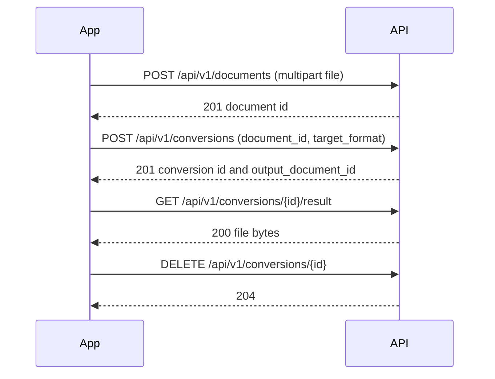

# API integration guide

This guide shows a complete client: upload a document, convert it, download the result, and delete it. The endpoint contract, including every error code, is in [ENDPOINTS.md](ENDPOINTS.md).

The examples assume the API is running locally:

```text
http://127.0.0.1:5000
```

Start it with the virtual environment from the [README](../README.md), then `python run.py`.

For manual browser testing, open `http://127.0.0.1:5000/web/debug`.

## Integration model

Treat the API as two resources.

1. **Document.** You upload bytes once. You receive an id. You can download those bytes again or delete them.
2. **Conversion.** You point it at a document id and a target format. The server reads the stored file, writes a new document, and returns the conversion. The original upload is unchanged.

Do not send the file again on the conversion call. If you need to convert the same file twice, create two conversions. Each one gets its own output document.



Conversion is synchronous. A `201` means the output file is already available. You do not poll. A `422` with `code` `conversion_failed` means the attempt was saved as `failed`; read `error.conversion_id` if you want the record.

## Errors in client code

Always branch on the HTTP status first, then on `error.code`.

```text
2xx  use body.data
204  no body
409  the resource is in the wrong state; read error.details
413  the file is too large; do not retry unchanged
415  the extension is not pdf or docx
422  validation_error: fix the request. Nothing was saved.
422  conversion_failed: the file was accepted earlier, but this file could not be converted.
404  the id is unknown
5xx  safe to retry a GET. Retry POST /conversions only if you are prepared for a second output.
```

The error shape is always:

```json
{
  "error": {
    "code": "validation_error",
    "message": "Request validation failed.",
    "details": [{ "field": "file", "message": "File is empty." }]
  }
}
```

Show `details[].message` to the user next to the field. Do not match on the top-level `message` alone; field text is in `details`.

`POST /conversions` can return `422` for two different reasons. Check `error.code`:

| `code` | What to do |
| --- | --- |
| `validation_error` | The client sent a bad body or an illegal format pair. No conversion row exists. |
| `conversion_failed` | The file is stored, but this conversion failed. `error.conversion_id` is the row. Fetch it if you want the stored message. Do not blindly retry the same file. |

## Limits to respect before uploading

| Check | Default |
| --- | --- |
| Extension | `.pdf` or `.docx` |
| Size | 1 byte through 20 MiB (`MAX_UPLOAD_BYTES`) |
| PDF | Starts with `%PDF-` and has `%%EOF` near the end |
| DOCX | ZIP containing `word/document.xml` |
| Direction | PDF → `docx`, DOCX → `pdf` only |

The server repeats these checks. Doing them in the client avoids a wasted upload.

## curl

### Convert in one request

Return the converted file directly:

```bash
curl -sS -o notes.docx \
  -F "file=@./notes.pdf" \
  -F "output=file" \
  http://127.0.0.1:5000/api/v1/convert
```

Or return JSON containing a download link:

```bash
curl -sS \
  -F "file=@./notes.pdf" \
  -F "output=link" \
  http://127.0.0.1:5000/api/v1/convert
```

### Health

```bash
curl -sS http://127.0.0.1:5000/api/v1/health
```

### Upload

```bash
curl -sS -D - \
  -F "file=@./quarterly-report.pdf;type=application/pdf" \
  http://127.0.0.1:5000/api/v1/documents
```

Save the `data.id` value. The `-D -` flag prints the `Location` header as well.

### Convert

```bash
curl -sS \
  -H "Content-Type: application/json" \
  -d '{"document_id":"DOCUMENT_ID","target_format":"docx"}' \
  http://127.0.0.1:5000/api/v1/conversions
```

Use `target_format` `pdf` when the upload was a DOCX.

### Download

```bash
curl -sS -L -o quarterly-report.docx \
  http://127.0.0.1:5000/api/v1/conversions/CONVERSION_ID/result
```

Or download by output document id:

```bash
curl -sS -L -o quarterly-report.docx \
  http://127.0.0.1:5000/api/v1/documents/OUTPUT_DOCUMENT_ID/content
```

### List and filter

```bash
curl -sS "http://127.0.0.1:5000/api/v1/documents?role=source&format=pdf&page=1&per_page=20"
curl -sS "http://127.0.0.1:5000/api/v1/conversions?document_id=DOCUMENT_ID&status=completed"
```

### Delete

Delete the conversion first if you want to keep the original upload:

```bash
curl -sS -X DELETE \
  http://127.0.0.1:5000/api/v1/conversions/CONVERSION_ID
```

Delete an upload that still has conversions:

```bash
curl -sS -X DELETE \
  "http://127.0.0.1:5000/api/v1/documents/DOCUMENT_ID?cascade=true"
```

Without `cascade=true` the second call returns `409`.

### One shell sequence

```bash
BASE=http://127.0.0.1:5000
DOC=$(curl -sS -F "file=@./notes.pdf" "$BASE/api/v1/documents")
DOC_ID=$(python -c "import json,sys; print(json.loads(sys.argv[1])['data']['id'])" "$DOC")
CONV=$(curl -sS -H "Content-Type: application/json" \
  -d "{\"document_id\":\"$DOC_ID\",\"target_format\":\"docx\"}" \
  "$BASE/api/v1/conversions")
CONV_ID=$(python -c "import json,sys; print(json.loads(sys.argv[1])['data']['id'])" "$CONV")
curl -sS -o notes.docx "$BASE/api/v1/conversions/$CONV_ID/result"
```

## Python

Uses the standard library plus `requests` (`pip install requests`). `requests` is a client dependency, not a server one.

```python
from pathlib import Path

import requests

BASE = "http://127.0.0.1:5000"
session = requests.Session()


def raise_for_api(response: requests.Response) -> dict | None:
    if response.status_code == 204:
        return None
    payload = response.json()
    if response.ok:
        return payload
    error = payload["error"]
    fields = "; ".join(
        f"{item['field']}: {item['message']}" for item in error.get("details", [])
    )
    raise RuntimeError(f"{response.status_code} {error['code']}: {fields or error['message']}")


def upload(path: Path) -> dict:
    with path.open("rb") as handle:
        response = session.post(
            f"{BASE}/api/v1/documents",
            files={"file": (path.name, handle, "application/octet-stream")},
            timeout=60,
        )
    return raise_for_api(response)["data"]


def convert(document_id: str, target_format: str) -> dict:
    response = session.post(
        f"{BASE}/api/v1/conversions",
        json={"document_id": document_id, "target_format": target_format},
        timeout=180,
    )
    return raise_for_api(response)["data"]


def download_result(conversion: dict, destination: Path) -> None:
    response = session.get(f"{BASE}{conversion['links']['result']}", timeout=60)
    response.raise_for_status()
    destination.write_bytes(response.content)


def main() -> None:
    document = upload(Path("notes.pdf"))
    conversion = convert(document["id"], "docx")
    if conversion["status"] != "completed":
        raise RuntimeError(conversion["error"])
    download_result(conversion, Path("notes.docx"))
    session.delete(f"{BASE}{conversion['links']['self']}", timeout=30).raise_for_status()


if __name__ == "__main__":
    main()
```

Notes for this client:

- Follow `links.result` and `links.self` from the JSON. Do not hard-code the id into a new path unless you have to.
- The conversion timeout should be longer than the upload timeout. Large PDFs and the first LibreOffice start are slower than a metadata call.
- The MIME type you send on upload is not trusted. The server detects the type from the bytes and the extension. `application/octet-stream` is fine.
- A failed conversion raises from `raise_for_api` because the status is `422`. Catch `RuntimeError` and, if you parsed the body yourself, read `error.conversion_id`.

Handling `conversion_failed` without raising:

```python
response = session.post(
    f"{BASE}/api/v1/conversions",
    json={"document_id": document_id, "target_format": "docx"},
    timeout=180,
)
body = response.json()
if response.status_code == 422 and body["error"]["code"] == "conversion_failed":
    failed_id = body["error"]["conversion_id"]
    record = session.get(f"{BASE}/api/v1/conversions/{failed_id}", timeout=30).json()
    print(record["data"]["error"]["message"])
```

## JavaScript (browser or Node 18+)

The browser example uses `fetch`. Do not set `Content-Type` yourself when sending `FormData`; the browser adds the multipart boundary.

```javascript
const BASE = "http://127.0.0.1:5000";

async function api(path, options = {}) {
  const response = await fetch(`${BASE}${path}`, options);
  if (response.status === 204) return null;
  const isJson = (response.headers.get("content-type") || "").includes("application/json");
  const payload = isJson ? await response.json() : await response.blob();
  if (!response.ok) {
    const error = payload.error || { code: "request_failed", message: response.statusText, details: [] };
    const fields = (error.details || []).map((item) => `${item.field}: ${item.message}`).join("; ");
    const failure = new Error(fields || error.message);
    failure.status = response.status;
    failure.code = error.code;
    failure.details = error.details || [];
    failure.conversionId = error.conversion_id || null;
    throw failure;
  }
  return payload;
}

export async function convertFile(file) {
  const form = new FormData();
  form.append("file", file, file.name);
  const uploaded = await api("/api/v1/documents", { method: "POST", body: form });

  const target = file.name.toLowerCase().endsWith(".pdf") ? "docx" : "pdf";
  const conversion = await api("/api/v1/conversions", {
    method: "POST",
    headers: { "Content-Type": "application/json" },
    body: JSON.stringify({
      document_id: uploaded.data.id,
      target_format: target,
    }),
  });

  const result = await fetch(`${BASE}${conversion.data.links.result}`);
  if (!result.ok) throw new Error("Download failed");
  return await result.blob();
}
```

From Node, without a browser `File` object:

```javascript
import { readFile, writeFile } from "node:fs/promises";

const file = await readFile("notes.pdf");
const form = new FormData();
form.append("file", new Blob([file]), "notes.pdf");

const uploaded = await api("/api/v1/documents", { method: "POST", body: form });
const conversion = await api("/api/v1/conversions", {
  method: "POST",
  headers: { "Content-Type": "application/json" },
  body: JSON.stringify({
    document_id: uploaded.data.id,
    target_format: "docx",
  }),
});

const download = await fetch(`${BASE}${conversion.data.links.result}`);
await writeFile("notes.docx", Buffer.from(await download.arrayBuffer()));
```

If the page calling the API is on another origin, the browser will block the response until you add CORS at your proxy. This service does not send CORS headers. Same-origin calls, server-side calls, and curl are unaffected.

## Recommended client flow

1. `GET /api/v1/health` once at startup. Stop if the status is not 200.
2. Validate extension and size locally.
3. `POST /api/v1/documents`.
4. Choose `target_format` from the returned `data.format`, not from a guess that might disagree with the file.
5. `POST /api/v1/conversions`.
6. On `201`, download `data.links.result`.
7. On `422` / `conversion_failed`, show the message and keep the source document so the user can try a different file.
8. When the user discards the result, `DELETE` the conversion. When they discard the upload as well, `DELETE` the document. Use `cascade=true` only for an explicit "delete everything about this file" action.

## Retries

| Call | Retry? |
| --- | --- |
| `GET` health, list, metadata, download | Yes, on network errors and `503` / `500` |
| `POST /documents` | Only if you did not receive a response. A retry stores a second copy of the same file. Compare `sha256` if you need to notice that. |
| `POST /conversions` | A retry always creates another conversion and another output file when it succeeds. Do not retry `conversion_failed` automatically. |
| `DELETE` | Retry on network errors. A follow-up `404` means the first attempt worked. |

The API has no idempotency key. If that matters, keep the returned ids in your own database and do not repeat a `POST` after you have stored them.

## Cleanup

Orphaned outputs consume disk until something deletes them. Pick one:

- Delete each conversion when your user is done with the download. This keeps the source.
- Delete the source with `?cascade=true` when the whole job should disappear.

Failed conversions have no output file. Deleting them only removes the history row.

## What this API will not do

- It will not convert images, HTML, legacy `.doc`, or `.xlsx`.
- It will not accept a target format equal to the source format.
- It will not overwrite a document in place. Every conversion creates a new document.
- It will not authenticate callers. Do not expose it to the public internet without a gateway.
